# Diagramas de flujos de punta a punta (E2E) — Emporio NaturalSur

**Versión:** 1.0 · **Fecha:** 11-11-2026 · Estado del código: rama `develop`

Estos diagramas describen el sistema **como está construido hoy** (dos perfiles, lotes, crédito con cupo,
anulación, sincronización). Se ven directamente en GitHub (formato Mermaid). Complementan los diagramas
UML de `docs/07-diagramas-uml/` y la guía `docs/11-pruebas/guia-e2e-demo.md`.

| N° | Diagrama | Qué muestra |
|---|---|---|
| 1 | Mapa del sistema | Módulos F1–F7 y quién los usa |
| 2 | Recorrido E2E completo | Las 7 escenas de la demo, de la compra al reporte |
| 3 | Venta | Flujo de decisiones de una venta |
| 4 | Venta (secuencia) | Qué hace cada capa al cobrar |
| 5 | Jornada de caja | Estados de la jornada |
| 6 | Estados de una venta | Pagada / anulada |
| 7 | Anular una venta | Reversas de stock, crédito y caja |
| 8 | Compra con lote | De la factura al stock |
| 9 | Vencimientos y mermas | Alerta, descuento sugerido y baja |
| 10 | Crédito de clientes | Consumo, cupo, abono y estado de cuenta |
| 11 | Sincronización | Cola local → Supabase, sin internet |
| 12 | Arquitectura por capas | Dominio, aplicación, infraestructura, interfaz |
| 13 | Modelo de datos | Tablas locales y sus relaciones |
| 14 | Despliegue | Computador del local y la nube |
| 15 | Ramas e integración | Cómo llega el código a `main` |
| 16 | Niveles de prueba | Qué se prueba y con qué |

## 1. Mapa del sistema

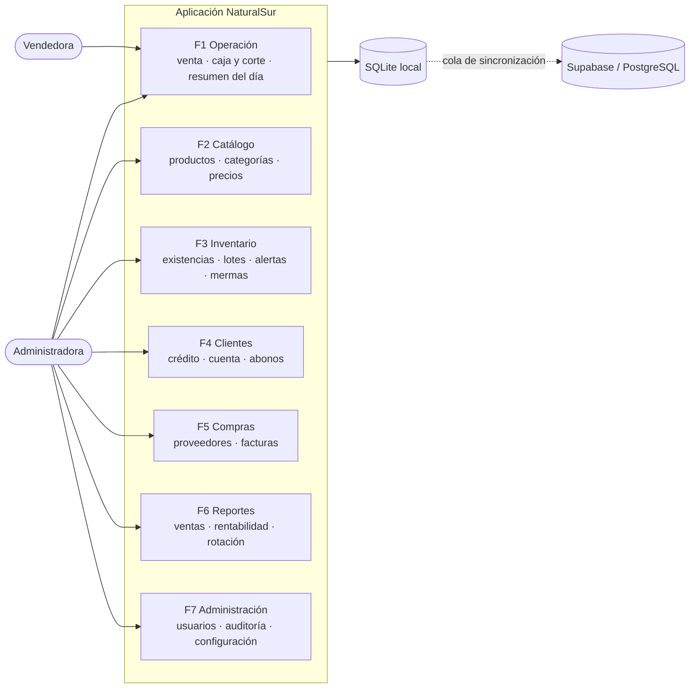

## 2. Recorrido E2E completo (las 7 escenas de la demo)

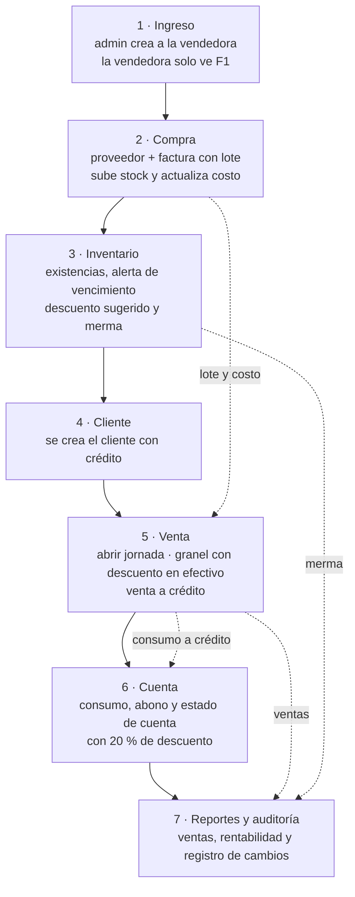

## 3. Venta — flujo de decisiones

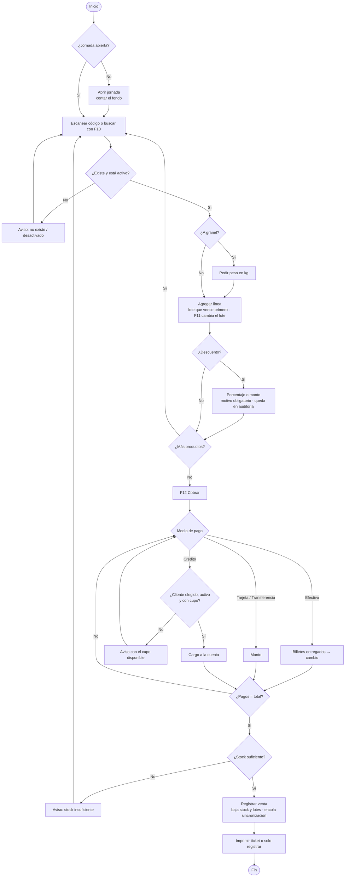

## 4. Venta — secuencia entre capas

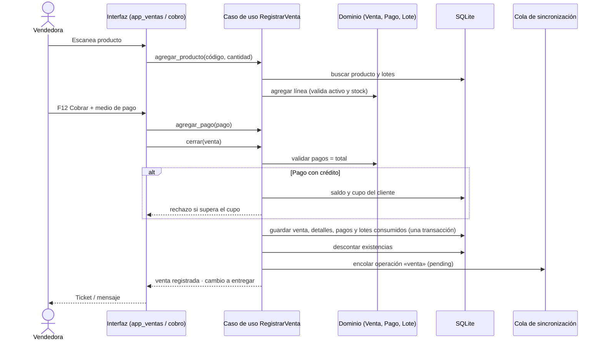

## 5. Jornada de caja

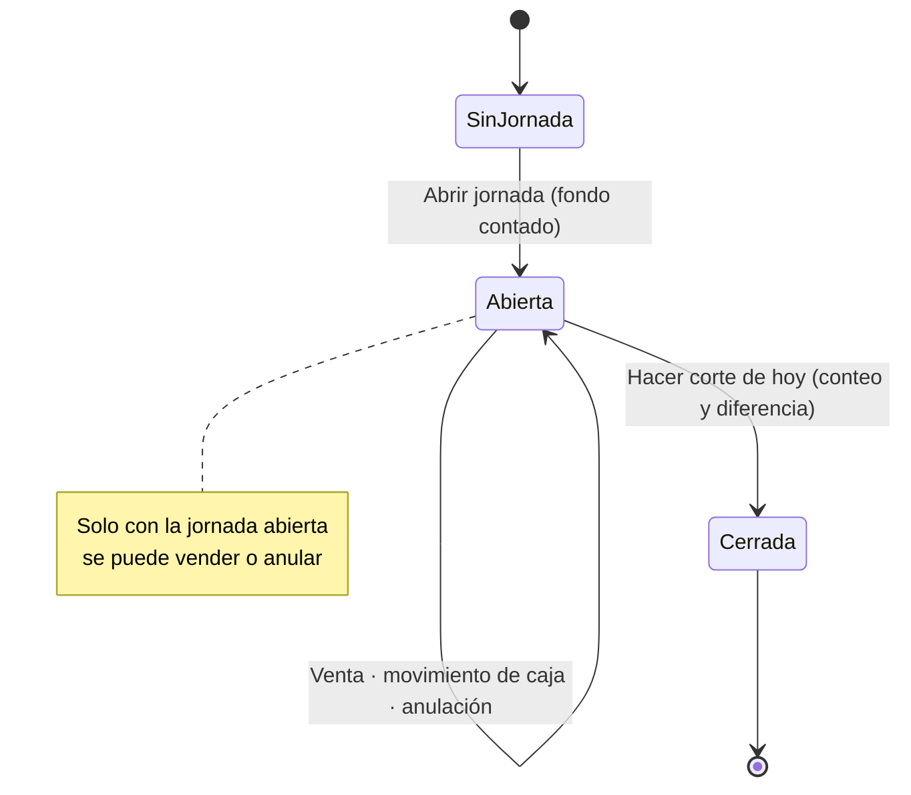

## 6. Estados de una venta

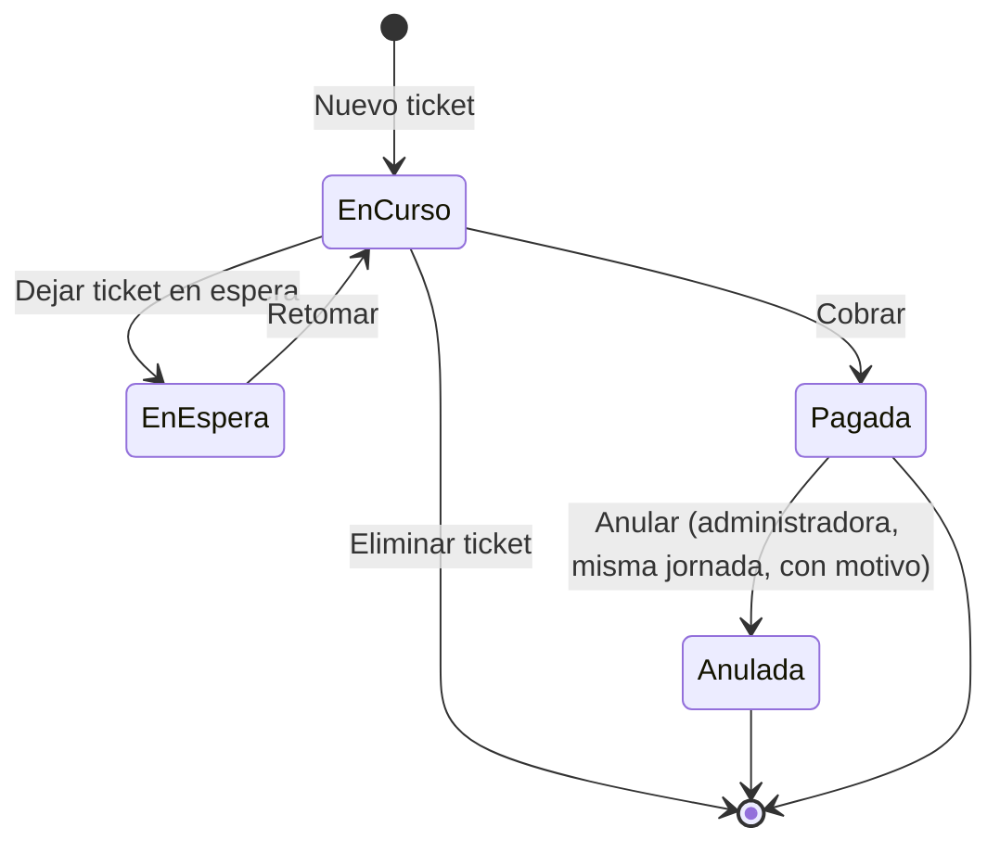

## 7. Anular una venta (HU-VTA-11)

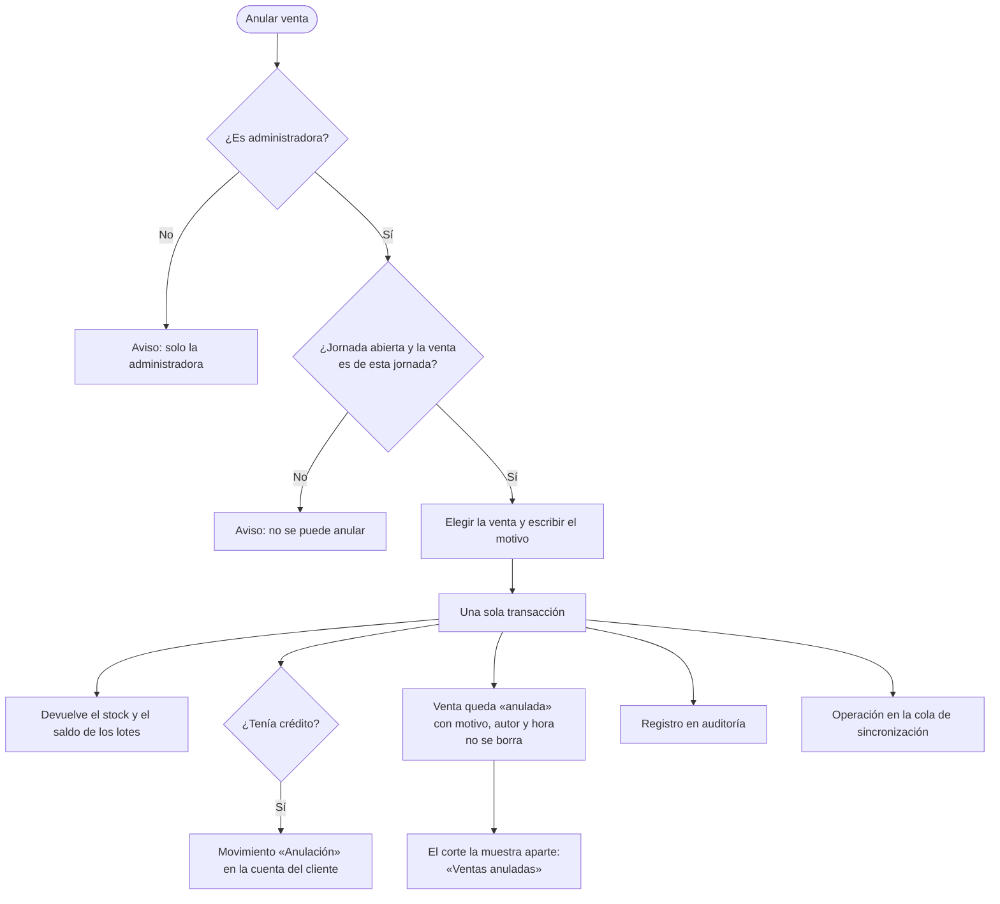

## 8. Compra con lote (F5)

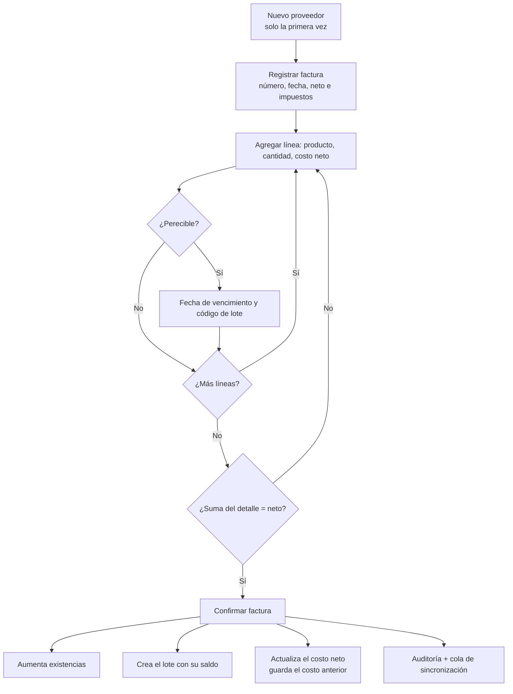

## 9. Vencimientos, descuento sugerido y mermas (F3)

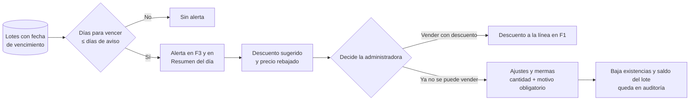

El descuento es una **sugerencia**: el sistema no cambia el precio solo.

## 10. Crédito de clientes (F4)

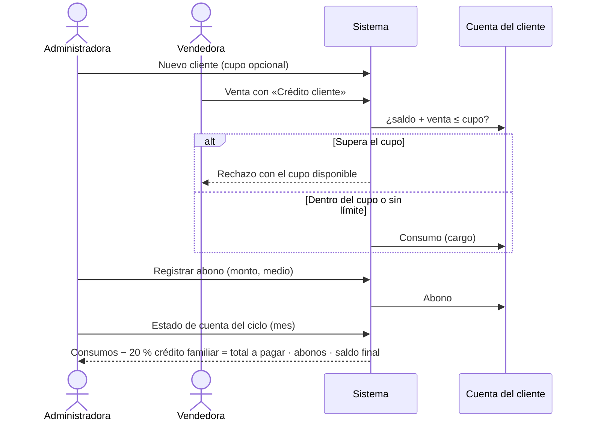

## 11. Sincronización sin internet (offline-first)

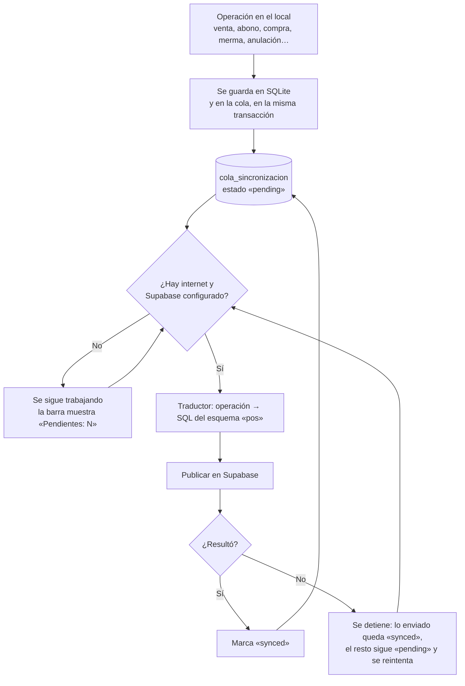

Cada operación lleva un identificador único del cliente, así un reintento **no duplica** datos en la nube.

## 12. Arquitectura por capas (hexagonal)

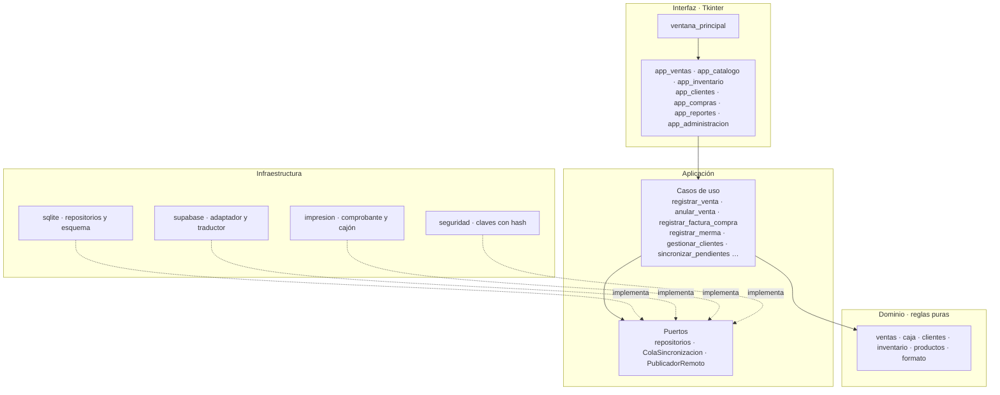

El dominio no conoce ni la base de datos ni la pantalla; por eso se prueba sin ellas.

## 13. Modelo de datos local (SQLite)

Se muestran las tablas principales y sus campos clave; el detalle está en `docs/06-modelo-datos/`.

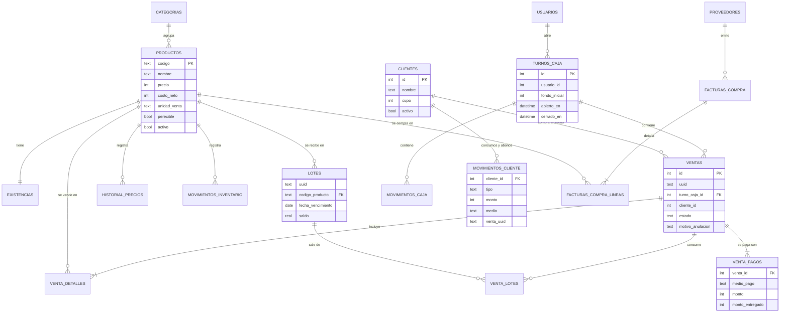

Tablas de apoyo sin relación directa: `auditoria`, `configuracion`, `tickets_en_espera`,
`historial_ajustes_inventario` y `cola_sincronizacion`.

## 14. Despliegue

```mermaid
flowchart LR
    subgraph LOCAL[Computador del local · Windows 8.1 de 64 bits]
        EXE[pos-naturalsur.exe<br/>empaquetado con PyInstaller]
        DB[(pos_local.db<br/>SQLite)]
        EXE --> DB
    end
    LECTOR[Lector de código<br/>de barras] --> EXE
    EXE --> IMP[Impresora térmica<br/>y cajón]
    EXE -. internet, cuando hay .-> SUP[(Supabase<br/>PostgreSQL · esquema «pos»)]
    DEV[Equipo de desarrollo<br/>GitHub] -. compila en VM Windows 8.1 .-> EXE
```

Pendiente de verificar con el equipo real: la impresora térmica (ver `checklist-de-termino.md`).

## 15. Ramas e integración

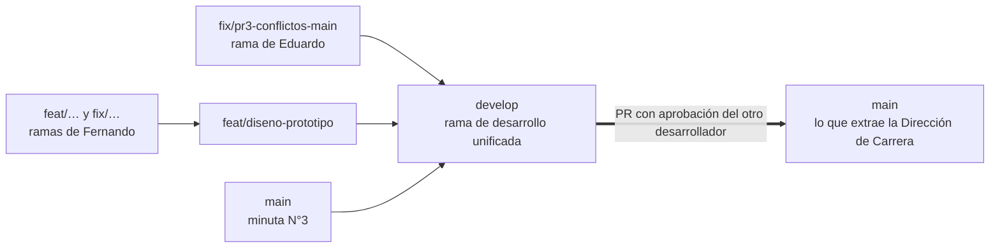

Estado al 11-11-2026: `develop` contiene todas las ramas; falta el PR `develop → main`.

## 16. Niveles de prueba

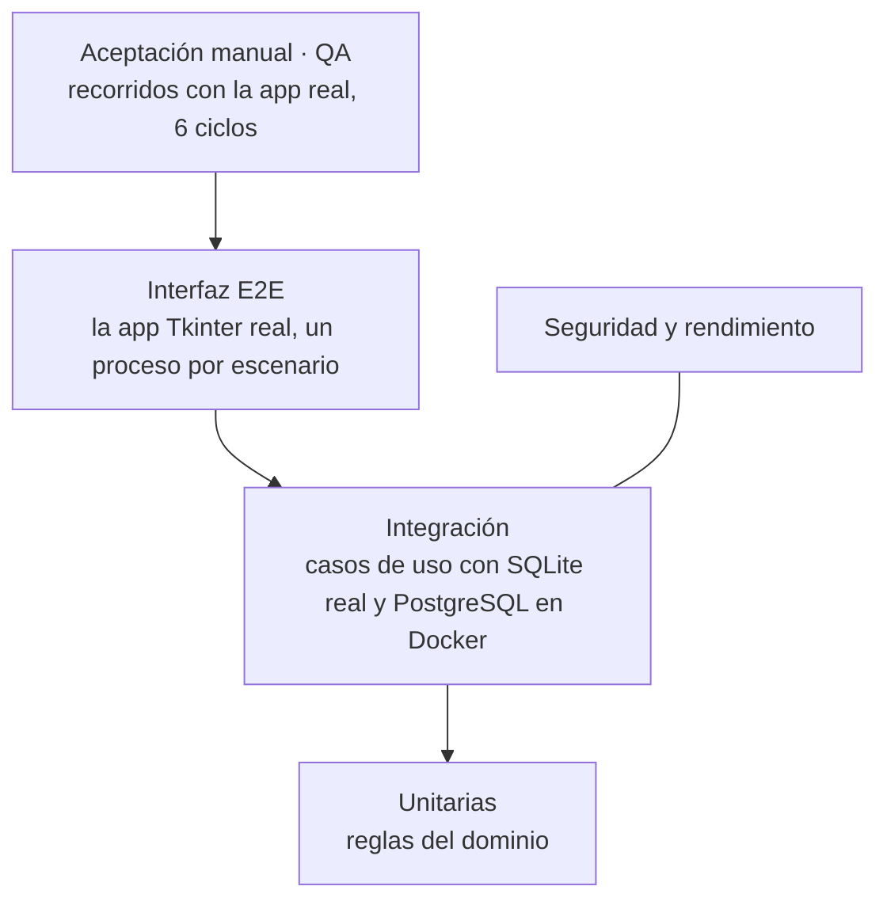

Resultados y casos: `docs/11-pruebas/casos-de-prueba.md`.
