# Manual de usuario — Punto de venta e inventario NaturalSur

**Versión:** 1.0 · **Fecha:** 11-11-2026 · **Para:** vendedoras y administradora del Emporio NaturalSur

Este manual explica cómo usar el sistema en el día a día del local. Las capturas se tomaron con datos de
ejemplo; en el computador del local (Windows) las pantallas son las mismas, solo cambia el marco de la
ventana. Para instalar el programa, ver `docs/12-despliegue/manual-de-implementacion.md`.

## 1. Lo básico

- El programa funciona **sin internet**. Todo se guarda en el computador y, cuando hay conexión, se copia
  solo a la nube. Abajo a la izquierda se ve cuántos movimientos faltan por copiar («Pendientes»).
- Hay dos perfiles:

| Qué puede hacer | Administradora | Vendedora |
|---|---|---|
| Vender, cobrar, abrir y cerrar la jornada de caja | Sí | Sí |
| Consultar productos | Sí | Sí |
| Crear o modificar productos, mermas, facturas de compra | Sí | No |
| Ver reportes y clientes, administrar usuarios, auditoría | Sí | No |
| Anular una venta | Sí | No |

- Los módulos se abren con las teclas **F1 a F7** o con un clic en la barra superior:
  **F1** Operación (venta y caja) · **F2** Catálogo · **F3** Inventario · **F4** Clientes · **F5** Compras ·
  **F6** Reportes · **F7** Administración. La vendedora solo tiene activo F1.

## 2. Ingresar y salir

1. Abrir el programa. Escribir **usuario** y **clave** y presionar **Entrar**.
2. La primera vez que se usa el programa, pide crear la administradora (clave de al menos 8 caracteres).
3. Arriba a la derecha aparece quién atiende. Ahí mismo están **Mi contraseña** (para cambiarla) y
   **Cerrar sesión**. Cerrar sesión siempre al terminar el turno.

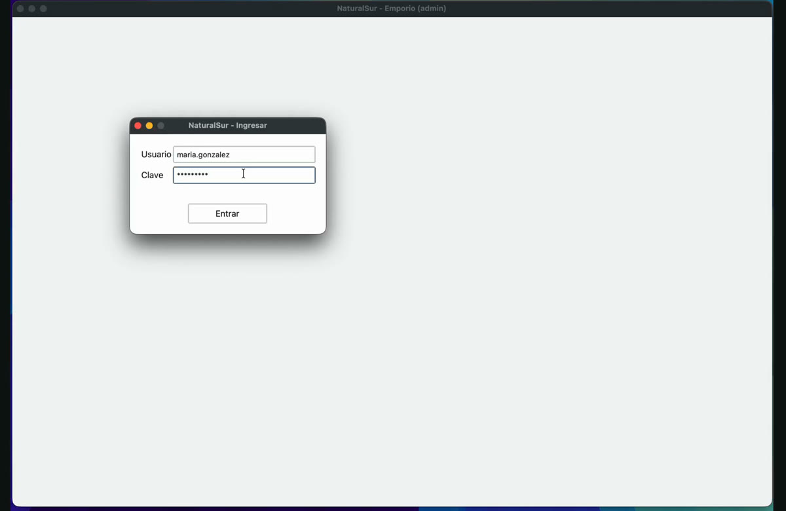

## 3. Vender (F1 Operación)

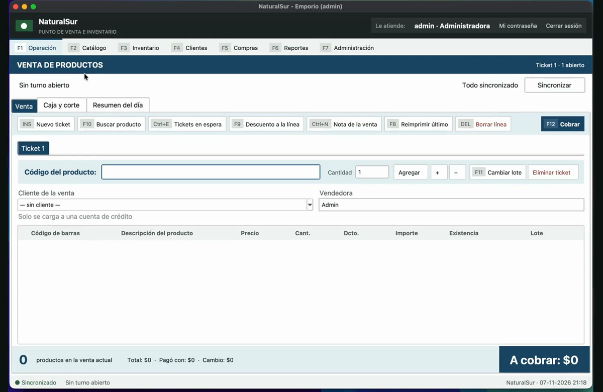

### 3.1 Abrir la jornada de caja

Antes de la primera venta del día hay que abrir la jornada:

1. F1 → pestaña **Caja y corte** → **Abrir jornada**.
2. Anotar cuántos billetes y monedas de cada tipo hay en la caja (el fondo). El programa suma solo.
3. **Confirmar**. Abajo queda «Turno abierto» con el fondo inicial.

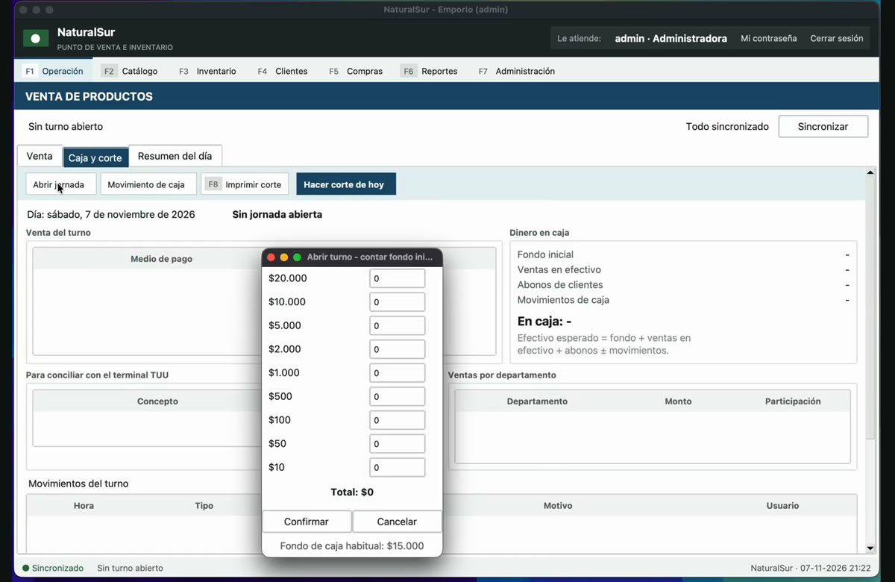

### 3.2 Agregar productos

1. En **Código del producto**, pasar el lector de código de barras o escribir el código y presionar Enter.
2. Si no se sabe el código, presionar **F10 (Buscar producto)**, escribir parte del nombre y elegirlo.
   Los productos desactivados aparecen en gris con «(desactivado)» y no se pueden vender.
3. Si el producto es **a granel**, el programa pide el **peso en kilos** (por ejemplo `0,350`) y calcula el
   importe.

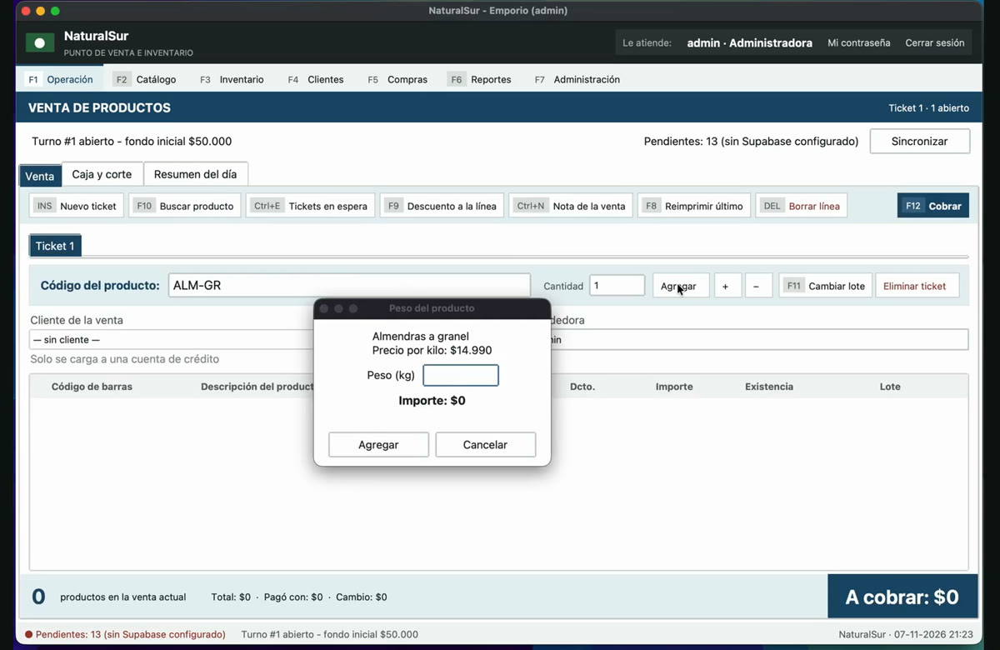

4. Para cambiar la cantidad usar los botones **+** y **−**. Para quitar un producto, seleccionarlo y usar
   **Borrar línea**.
5. Si el producto tiene varios lotes, el programa elige el que vence primero. Con **F11 (Cambiar lote)**
   se puede elegir otro.
6. **Nuevo ticket (Ins)** abre otra venta en paralelo sin perder la actual (por ejemplo, si un cliente
   fue a buscar algo más).

### 3.3 Hacer un descuento

1. Seleccionar el producto y presionar **Descuento a la línea**.
2. Elegir porcentaje o monto, escribir el valor y elegir el **motivo** (es obligatorio).
3. **Aplicar**. El descuento queda registrado en la auditoría con el nombre de quien lo hizo.

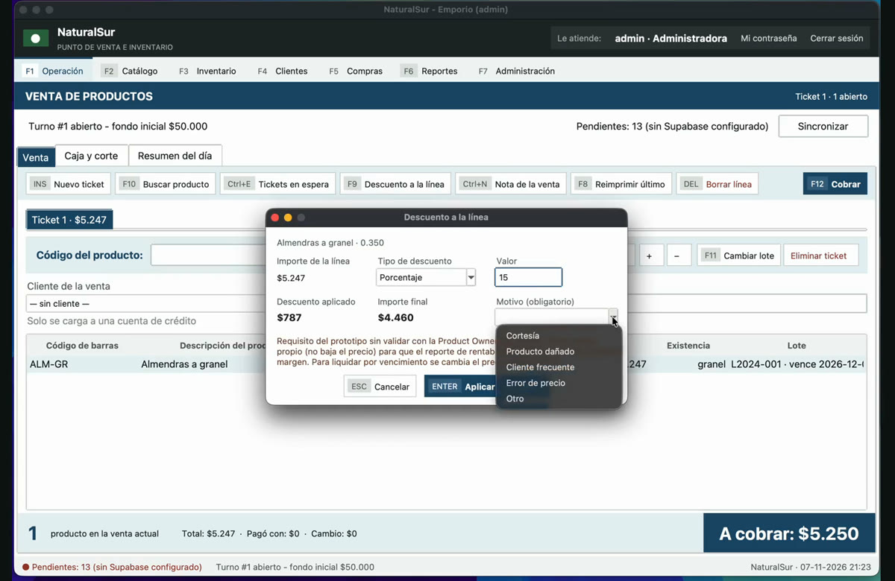

### 3.4 Cobrar

1. Presionar **F12 (Cobrar)**.
2. Elegir el medio de pago: **Efectivo**, **Tarjeta** (terminal TUU), **Transferencia** o **Crédito
   cliente**.
3. En efectivo, anotar los billetes que entrega el cliente (o escribir el monto) y presionar **Agregar
   pago**. El programa muestra el **cambio** que hay que entregar.
4. Se pueden combinar medios de pago: agregar un pago por una parte y otro por el resto.
5. Terminar con **F1 Cobrar e imprimir ticket** o **F2 Cobrar solo registrando la venta**. **Esc** cancela.

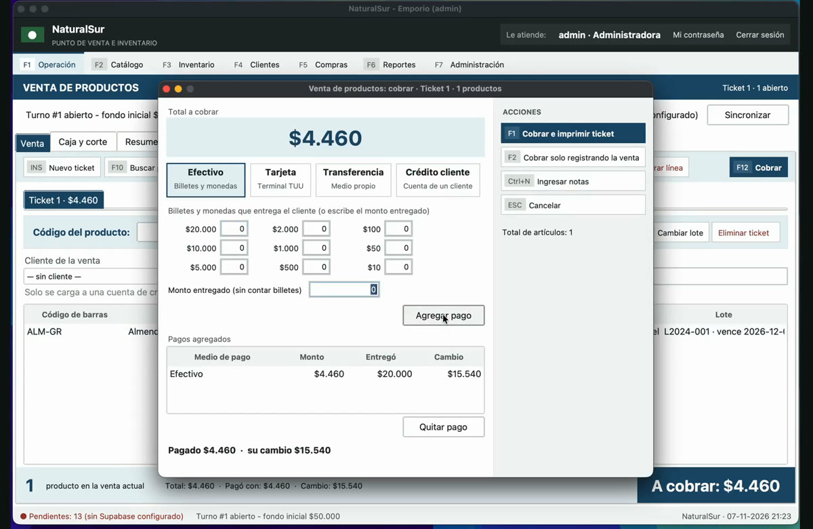

### 3.5 Vender a crédito (cuenta de un cliente)

1. Antes de cobrar, elegir al cliente en **Cliente de la venta**.
2. Al cobrar, elegir **Crédito cliente**. La venta se carga a su cuenta.
3. Si el cliente tiene un **cupo** y la venta lo supera, el programa avisa cuánto cupo le queda y no deja
   cargarla: se cobra con otro medio o se reduce la venta.

### 3.6 Movimientos de caja y cierre

- **Caja y corte → Movimiento de caja**: para registrar un ingreso de sencillo o un retiro de dinero.
- **Caja y corte → Hacer corte de hoy**: al terminar el día, contar el dinero y cerrar la jornada. El corte muestra
  lo vendido por medio de pago, el efectivo que debería haber y la diferencia.
- La pestaña **Resumen del día** muestra las ventas y la meta del día, y avisa lo que necesita atención
  (por ejemplo, productos sin costo). El enlace **Ver →** lleva directo a corregirlo.

### 3.7 Anular una venta (solo administradora)

1. F1 → **Caja y corte** → **Anular venta**.
2. Elegir la venta, escribir el **motivo** y confirmar.
3. La venta no se borra: queda marcada como anulada, el stock vuelve, y si era a crédito se descuenta de
   la cuenta del cliente. El corte la muestra aparte. Solo se pueden anular ventas de la jornada abierta.

## 4. Catálogo de productos (F2)

- **Nuevo producto**: código, nombre, categoría, precio de venta, costo neto y si es perecible o a granel.
- Para modificar un producto, seleccionarlo en la lista y editarlo. Un producto que ya no se vende se
  **desactiva** (no se borra, para conservar su historia).
- Los filtros de la lista permiten ver, por ejemplo, los productos **sin costo** cargado. Sin costo, el
  programa no puede calcular la ganancia de ese producto.

## 5. Inventario (F3)

- **Existencias**: cuánto hay de cada producto.
- **Lotes y vencimientos**: cada lote con su fecha de vencimiento y saldo.
- **Alertas**: productos que están por vencer, con un **descuento sugerido** y el precio rebajado. Es una
  sugerencia: el precio no cambia solo.

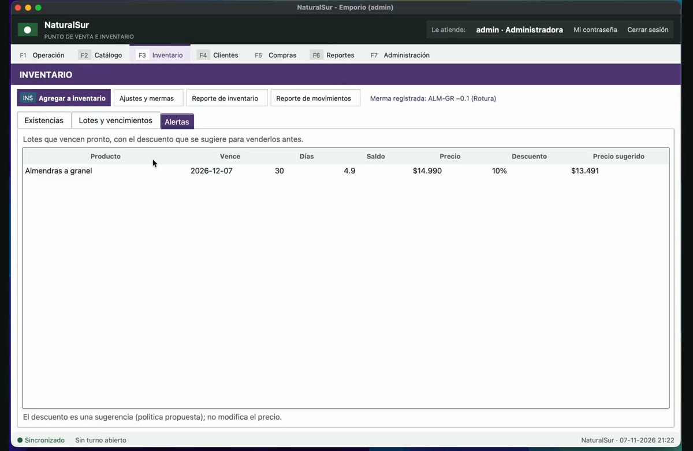

- **Ajustes y mermas**: para dar de baja producto roto, vencido o perdido. Escribir el código, la cantidad
  y el **motivo** (obligatorio), y presionar **Registrar merma**.

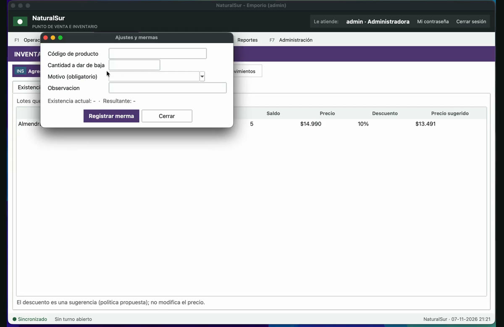

## 6. Clientes y crédito (F4)

- **Nuevo cliente**: nombre y teléfono. Opcionalmente un **cupo de crédito** (si se deja vacío, no tiene
  límite). La lista muestra el saldo, el cupo y lo disponible de cada cliente.
- **Cuenta**: elegir al cliente (se puede escribir parte del nombre) para ver sus consumos y abonos.
- **Registrar abono**: monto, fecha y medio de pago. Muestra el saldo que quedará.

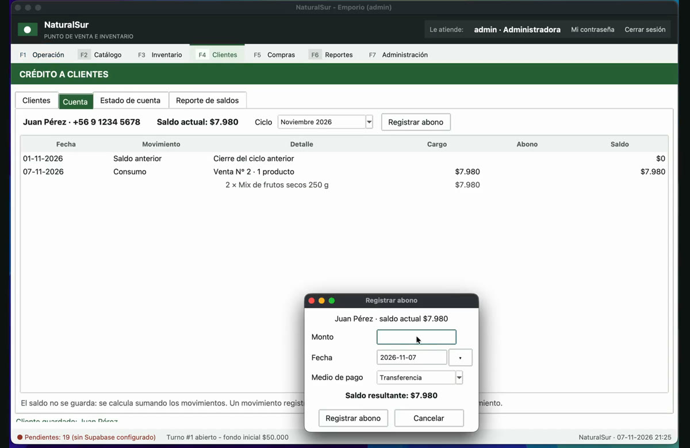

- **Estado de cuenta**: resumen del mes (ciclo) con los consumos, el **descuento del crédito familiar
  (20 %)**, el total a pagar, los abonos y el saldo final. Se puede exportar.

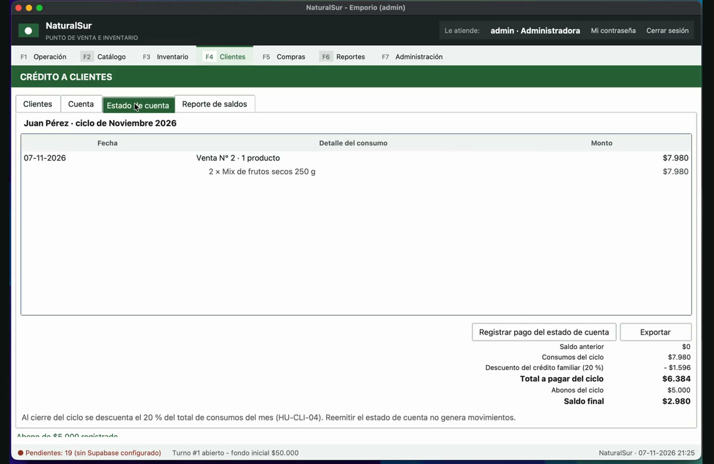

## 7. Compras (F5)

1. **Nuevo proveedor** (solo la primera vez que se le compra).
2. **Registrar factura**: elegir proveedor, número de documento, fecha, monto neto e impuestos.
3. Por cada producto: código, cantidad, costo unitario neto y, si es perecible, **fecha de vencimiento y
   código de lote**. Presionar **Agregar línea**.
4. Cuando la suma del detalle calza con el neto, **Confirmar factura (Ctrl+Enter)**. Al confirmar, el
   stock aumenta, se crea el lote y el costo del producto se actualiza.

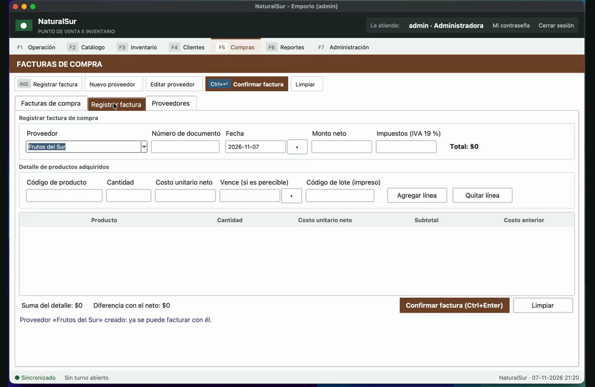

## 8. Reportes (F6)

- **Ventas**: elegir fechas y **Generar**. Muestra cantidad de ventas, total, ticket promedio y el detalle
  por categoría y por medio de pago.

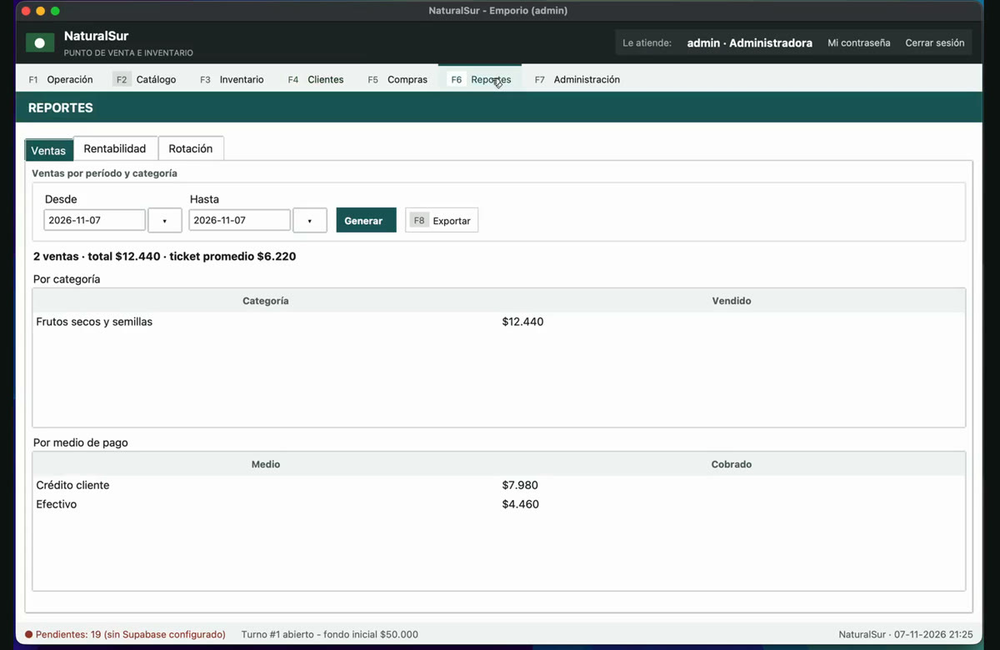

- **Rentabilidad**: ganancia y margen por producto. Usa el costo que tenía el producto al momento de la
  venta y la venta sin IVA.

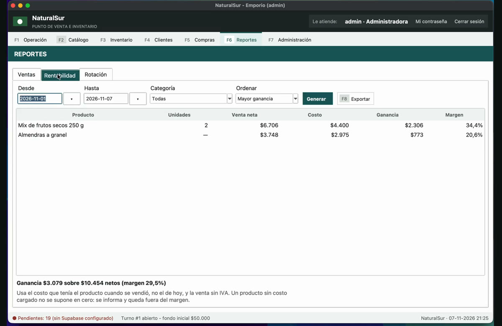

- **Rotación**: qué productos se mueven más y cuáles menos.
- **F8 Exportar** guarda el reporte en un archivo.

## 9. Administración (F7)

- **Usuarios**: **Nuevo usuario** (usuario, contraseña de al menos 8 caracteres y perfil), **Restablecer
  contraseña**, **Cambiar perfil** y **Desactivar / reactivar**. Abajo se ve qué puede hacer cada perfil.

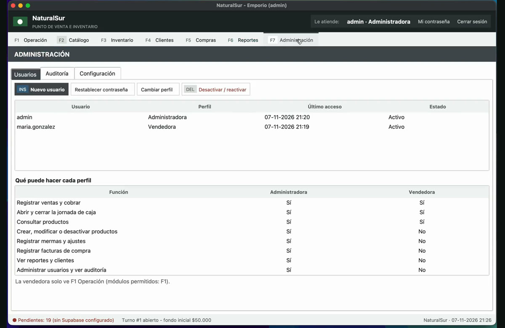

- **Auditoría**: lista de los cambios sensibles (descuentos, mermas, facturas, anulaciones, usuarios) con
  fecha, quién lo hizo y el valor de antes y después. Es solo lectura: no se puede editar ni borrar.

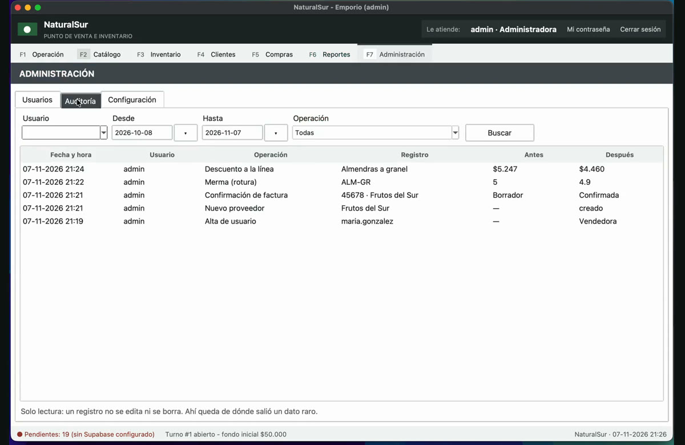

- **Configuración**: parámetros del local.

## 10. Preguntas frecuentes

| Situación | Qué hacer |
|---|---|
| «Sin turno abierto» y no deja vender | Abrir la jornada en F1 → Caja y corte (sección 3.1) |
| Se cortó internet | Seguir vendiendo normal. Los pendientes se envían solos al volver la conexión, o con el botón **Sincronizar** |
| El producto no aparece al pasar el código | Buscarlo con **F10** por nombre; si no existe, la administradora lo crea en F2 |
| Aviso «está desactivado» | El producto fue desactivado en el catálogo; la administradora puede reactivarlo en F2 |
| No deja vender a crédito | El cliente superó su cupo: cobrar con otro medio o registrar un abono en F4 |
| Me equivoqué en una venta ya cobrada | La administradora la anula (sección 3.7) y se hace de nuevo |
| Olvidé mi clave | La administradora la restablece en F7 → Usuarios |
| Un módulo aparece bloqueado | El perfil de vendedora solo tiene acceso a F1 |

## 11. Atajos de teclado

| Tecla | Acción |
|---|---|
| F1 a F7 | Cambiar de módulo |
| Ins | Nuevo ticket (en venta) |
| F10 | Buscar producto |
| F11 | Cambiar lote |
| F12 | Cobrar |
| F1 / F2 (en la ventana de cobro) | Cobrar e imprimir / cobrar solo registrando |
| Esc | Cancelar |
| Ctrl+Enter | Confirmar factura de compra |
| F8 | Exportar reporte |
